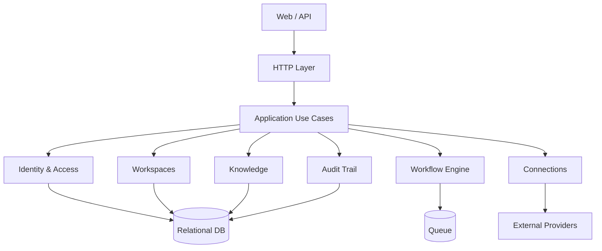

# Azhura

<p align="center"><strong>Build systems that move ideas forward.</strong><br>A modular PHP platform for orchestrating workspaces, workflows, knowledge and integrations.</p>

<p align="center"><a href="docs/GETTING_STARTED.md">Get started</a> · <a href="docs/ARCHITECTURE.md">Architecture</a> · <a href="docs/API.md">API</a> · <a href="docs/ROADMAP.md">Roadmap</a> · <a href="SECURITY.md">Security</a></p>

<p align="center">   </p>

> Azhura is being built in public. This repository contains the initial application foundation and first implementation slice. APIs and modules may evolve before the first stable release.

## ✨ Overview

Azhura is an extensible platform foundation for connected digital environments. It is organized around focused domains that can be composed into larger products.

- **Workspaces** — isolated spaces for teams and shared resources.
- **Flow engine** — auditable workflow definitions and executions.
- **Knowledge** — structured pages and searchable content.
- **Connections** — external services and webhooks.
- **Identity & access** — users, roles and tenant-aware authorization.
- **Audit trail** — traceable records of important activity.

## 🧭 Principles

| Principle | Meaning |
| --- | --- |
| Modular by default | Focused domains with explicit boundaries. |
| Secure by design | Authorization, validation and safe defaults first. |
| API-first | Versioned HTTP APIs documented with the code. |
| Observable | Important actions and failures are traceable. |
| Incremental | Ship working vertical slices, not empty subsystems. |

## 🧱 Stack

PHP 8.3+ · Laravel 13 · PostgreSQL (recommended) / SQLite (local) · Redis (production queues/cache) · PHPUnit.

Laravel 13 requires PHP 8.3+. See the [official release notes](https://laravel.com/docs/13.x/releases).

## 🚀 Quick start

```bash
git clone https://github.com/dyfiydkyckg-create/Azhura.git
cd Azhura
composer install
cp .env.example .env
php artisan key:generate
touch database/database.sqlite
php artisan migrate
php artisan test
php artisan serve
```

Health endpoint: `http://127.0.0.1:8000/api/v1/health`. Full setup: [Getting Started](docs/GETTING_STARTED.md).

## 🗺️ Architecture



See the [Architecture Guide](docs/ARCHITECTURE.md) and [ADR 0001](docs/decisions/0001-modular-monolith.md).

## 📚 Documentation

| Guide | Description |
| --- | --- |
| [Getting Started](docs/GETTING_STARTED.md) | Requirements, installation and local development |
| [Architecture](docs/ARCHITECTURE.md) | Layers, modules and boundaries |
| [API Reference](docs/API.md) | API conventions and health endpoint |
| [Roadmap](docs/ROADMAP.md) | Milestones and planned capabilities |
| [Security](SECURITY.md) | Vulnerability reporting and secure development |
| [Contributing](CONTRIBUTING.md) | Branches, commits, tests and pull requests |
| [Changelog](CHANGELOG.md) | Notable changes |

## 🧪 Quality checks

```bash
composer validate --strict
composer test
composer format:check
composer analyse
```

## 🤝 Contributing

Contributions are welcome. Read [CONTRIBUTING.md](CONTRIBUTING.md) and [CODE_OF_CONDUCT.md](CODE_OF_CONDUCT.md).

## 📄 License

Released under the [MIT License](LICENSE).

<p align="center"><sub>Designed for clarity. Built for change. Powered by PHP.</sub></p>
