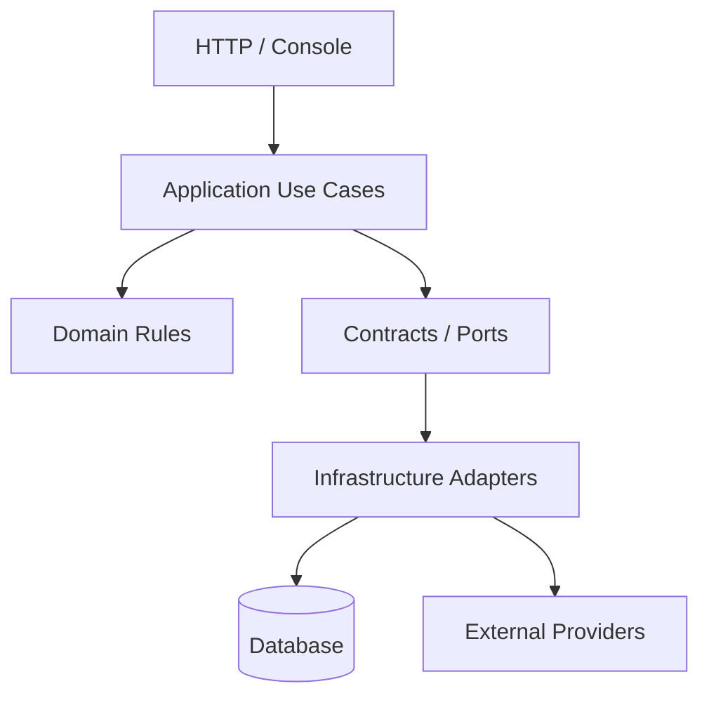

# Architecture

Azhura starts as a **modular monolith**: one Laravel application with strong internal boundaries. This keeps operations simple while domain boundaries mature.

## Layers

| Layer | Responsibility | Examples |
| --- | --- | --- |
| HTTP | Protocol, authentication, validation, serialization | Controllers, requests, API resources |
| Application | Use cases and transaction boundaries | Workspace creation, workflow execution |
| Domain | Business rules and invariants | Membership rules, workflow states |
| Infrastructure | Persistence and external systems | Eloquent, queues, HTTP clients |

Controllers stay thin. Business operations belong in application services. Domain modules must not depend on HTTP controllers.

## Bounded contexts

- **Identity & access:** users, authentication, roles, permission checks.
- **Workspaces:** workspace lifecycle, membership and settings.
- **Workflow engine:** definitions, validation, execution and run history.
- **Knowledge:** pages, publishing lifecycle and search indexing.
- **Connections:** provider credentials, webhooks, retries and delivery history.
- **Audit:** append-oriented records of security-sensitive and business-significant actions.

## Data ownership

- Every tenant-owned record belongs to a workspace.
- Cross-workspace access is denied by default.
- Modules interact through application contracts or domain events.
- Schema changes use reviewed, reversible migrations.
- Destructive actions should be auditable.

## Dependency direction

## Current implementation

The initial foundation includes Laravel bootstrap, a versioned health endpoint, workspace/workflow/knowledge/audit persistence models, migrations, and workspace/audit application services. Authentication flows, tenant policies, workflow execution and provider integrations remain planned work.
